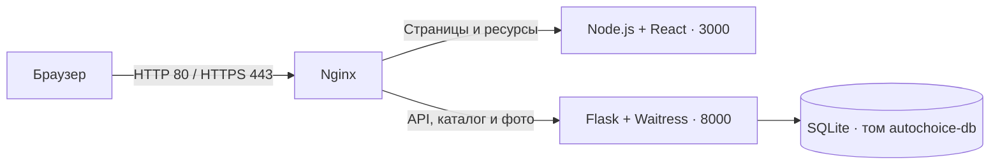
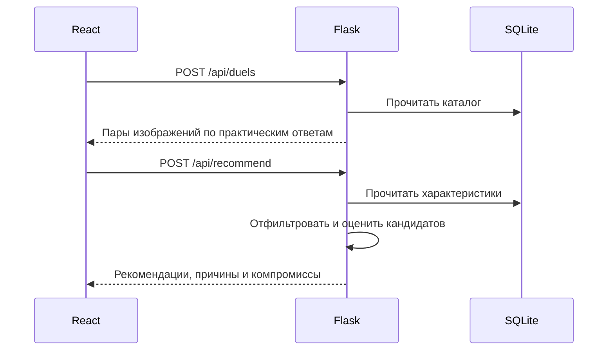

# AutoChoice

**Веб-сервис подбора автомобиля по потребностям и предпочтениям.** Пользователь проходит 10 практических вопросов и 5 визуальных дуэлей, получает рекомендации с объяснениями и сравнивает подходящие модели.

[Открыть AutoChoice](https://hack-ovb-08-vm1-86a371.vm.prodcontest.com/) · [Swagger UI](https://hack-ovb-08-vm1-86a371.vm.prodcontest.com/api/docs) · [Панель диагностики](https://hack-ovb-08-vm1-86a371.vm.prodcontest.com/monitor.html)

**Стек** · React · TypeScript · Vite · Node.js · Flask · Waitress · SQLite · Nginx · Docker Compose · GitLab CI/CD

[Архитектура](#архитектура) · [Данные и подбор](#данные-и-подбор) · [API](#api) · [Локальный запуск](#локальный-запуск) · [Деплой](#деплой) · [Проверки и диагностика](#проверки-и-диагностика)

## Архитектура

AutoChoice запускается в трёх контейнерах. Nginx принимает внешние запросы и разделяет трафик по URL. Node.js раздаёт сборку React. Flask валидирует входные данные, читает каталог и рассчитывает рекомендации. SQLite хранится в томе бэкенда.



| Компонент | Ответственность | Основные файлы |
| --- | --- | --- |
| Nginx | Завершает TLS на ВМ и маршрутизирует запросы. Порты 3000 и 8000 используются внутри сети Compose. | [Локальная конфигурация](nginx/local.conf), [конфигурация ВМ](nginx/default.conf) |
| Фронтенд | Ведёт анкету, запрашивает данные, показывает объяснения, сравнивает до трёх автомобилей и формирует PNG в браузере. | [App.tsx](frontend/src/App.tsx), [компоненты](frontend/src/format.tsx), [PNG](frontend/src/share.ts), [Node-сервер](frontend/server.mjs) |
| HTTP API | Проверяет запросы, отдаёт JSON и фото, формирует OpenAPI, собирает диагностические данные. | [app.py](backend/app.py), [OpenAPI](backend/openapi.json) |
| Подбор | Применяет обязательные ограничения, рассчитывает оценки и формирует пояснения. | [engine.py](backend/engine.py) |
| Каталог | Читает CSV, проверяет типы и диапазоны, синхронизирует записи с SQLite. | [catalog.py](backend/catalog.py), [данные каталога](backend/cars/) |

React обращается к API по относительным URL. Страница, фотографии и API доступны браузеру с одного origin. В режиме разработки Vite перенаправляет `/api`, `/cars` и `/health` на локальный Flask.

Прогресс анкеты и тема хранятся в `localStorage` браузера. В API отправляются ответы, необходимые для конкретного расчёта. SQLite используется для каталога. При повторном открытии пользователь может продолжить анкету с сохранённого шага.

## Данные и подбор

### Каталог

В поставке 100 записей автомобилей с фотографиями. `cars.csv` содержит идентификаторы, комплектации, технические характеристики, оценки, источники и даты проверки. `assessments.csv` поясняет происхождение предварительных оценок. Изображения хранятся в `backend/cars/images/` и отдаются через API бэкенда.

При запуске Flask создаёт таблицу `cars`, если её ещё нет. Импорт обновляет записи по первичному ключу `id` и удаляет отсутствующие в принятом снимке CSV записи в одной транзакции. При невалидном или пустом обновлении существующего каталога сохраняются данные последнего успешного импорта. `/api/catalog/status` показывает число записей, ошибки и предупреждения импорта.

При загрузке главной страницы backend случайно выбирает до трёх разных моделей из SQLite. Подписи карточек зависят от характеристик выбранных машин. Ответ этого маршрута помечен `no-store`.

### От анкеты к рекомендациям



1. **Валидация.** Сервер проверяет варианты ответов, число значений и дополнительные поля, например свою границу бюджета.
2. **Обязательные условия.** Бюджет, число мест, привод и другие выбранные требования применяются до ранжирования. Для диагностики отдельно учитываются несоответствия и неизвестные характеристики.
3. **Оценки.** Рациональный и эмоциональный рейтинги вычисляются по взвешенным признакам. Базовая оценка по известным характеристикам равна `20 × Σ(вес × оценка признака) / Σ(вес)`, где оценка признака лежит от 0 до 5. Финальный рейтинг учитывает покрытие признаков и информативность анкеты.
4. **Выдача.** Сервис формирует «Разумный выбор», «Твой баланс» и «Выбор сердцем» с разными моделями, если хватает кандидатов. Карточки показывают аргументы, компромиссы и альтернативы. Автомобильная ДНК описывает предпочтения, которые можно вывести из анкеты.
5. **Пересчёт.** Пользователь может изменить ответ и получить новый результат. При отсутствии совпадений сервис показывает, какие условия исключили машины, и предлагает посчитанные варианты изменения одного ограничения.

Интерфейс отличает `matches`, `no_matches`, `needs_answers` и `empty`. При пропуске всех содержательных вопросов он предлагает дополнить анкету. Первый вопрос открывается после секундной анимации. После завершения анкеты экран загрузки показывается две секунды, если ответ готов. Запрос идёт параллельно анимации. При включённом системном снижении анимации эта задержка пропускается.

> Цены и предварительные оценки безопасности и надёжности предназначены для сравнительного подбора. Оценка совместимости выражает соответствие анкете. За результатами испытаний и сведениями о конкретной комплектации следует обращаться к первоисточникам.

## API

Интерактивная спецификация доступна на `/api/docs`, JSON-контракт на `/api/openapi.json`. Допустимые значения вопросов для спецификации и `/api/question-contract` берутся из серверного валидатора.

| Метод и путь | Назначение |
| --- | --- |
| `GET /health` | Проверить доступ к SQLite. |
| `GET /api/catalog/status` | Проверить результат импорта и размер каталога. |
| `GET /api/cars` | Получить каталог с характеристиками и ссылками на фотографии. |
| `GET /api/home-picks` | Получить случайные карточки для главной. |
| `GET /api/question-contract` | Получить допустимые значения ответов и ограничения множественного выбора. |
| `POST /api/duels` | Подобрать пары изображений по практическим ответам. |
| `POST /api/recommend` | Рассчитать рекомендации и объяснения по анкете. |
| `POST /api/explain-car` | Объяснить результат для конкретной машины по её `car_id`. |
| `GET /api/metrics` | Получить счётчики, ошибки и среднее время ответа по маршрутам. |
| `GET /cars/images/<name>` | Получить фотографию автомобиля. |
| `GET /cars/catalog.csv` | Скачать исходный CSV каталога. |

Пример подбора машин с бюджетом до 2 млн рублей для езды по городу.

```bash
curl -fsS http://localhost/api/recommend \
  -H 'Content-Type: application/json' \
  -d '{"answers":{"1":"under2","3":["city"]},"balance":50}'
```

Запрос с некорректными ответами получает `400`, запрос неизвестной модели для объяснения получает `404`. Flask ограничивает тело запроса до 16 КиБ и возвращает `413` при превышении лимита. При недоступности каталога ответ может содержать `503`. Идентификатор `X-Request-ID` помогает найти запись по запросу в логах.

## Локальный запуск

**Docker Engine и Docker Compose v2** должны быть установлены. Из корня проекта выполните:

```bash
docker compose up --build -d
docker compose ps
```

Откройте [сайт](http://localhost/), [Swagger UI](http://localhost/api/docs) или [панель диагностики](http://localhost/monitor.html). Если порт 80 занят, задайте свободный порт в `.env` на основе [.env.example](.env.example), например `APP_PORT=8080`, и используйте его в адресе. Для локального запуска Compose подключает HTTP-конфигурацию Nginx.

Проверка приложения и просмотр логов:

```bash
python scripts/smoke_http.py http://localhost
docker compose logs --tail=100 nginx frontend backend
```

`docker compose down` завершает работу контейнеров. Том SQLite сохраняется при обычной остановке. Команда `down -v` удаляет том.

### Разработка

Запустите Flask в одном терминале, а Vite в другом. Стек разработки использует Python 3.12 и Node.js 22.

```bash
# Терминал 1, из корня проекта
python -m pip install -r backend/requirements.txt
python backend/app.py
```

```bash
# Терминал 2, из корня проекта
cd frontend
npm ci
npm run dev
```

Vite слушает порт 3000, Flask — 8000. При наличии `frontend/dist/index.html` Flask также может отдать собранный интерфейс напрямую на порту 8000. Для пересборки выполните `npm run build` в папке `frontend`.

## Деплой

В GitLab обычный pipeline проверяет комплектность, запускает серверные тесты, собирает React, запускает браузерный сценарий и валидирует конфигурации Compose. После успешных проверок в основной ветке задача `deploy:vm` передаёт исходники на ВМ по SSH. Скрипт собирает три образа непосредственно на ВМ и помечает их SHA коммита. [Конфигурация CI](.gitlab-ci.yml) · [Сценарий релиза](deploy/release_on_vm.sh)

| Параметр | Как используется |
| --- | --- |
| `DEPLOY_HOST`, `DEPLOY_USER`, `DEPLOY_PORT` | Адрес и SSH-пользователь ВМ. Порт по умолчанию 22. |
| `DEPLOY_KEY` или `DEPLOY_SSH_KEY` | Приватный SSH-ключ через CI-переменную типа **File**. |
| `DEPLOY_KNOWN_HOSTS` | CI-переменная типа **File** с проверенным ключом хоста. При её наличии CI требует совпадения ключа. |
| `IMAGE_PREFIX`, `IMAGE_TAG` | Префикс и тег образов. Скрипт записывает их в `release.env` для конкретного релиза. |
| `AUTOCHOICE_DB_PATH` | Путь к SQLite. В контейнере используется `/data/autochoice.db` на постоянном томе. |

На ВМ Docker должен быть доступен пользователю деплоя напрямую или через `sudo -n`. Production Compose публикует порты 80 и 443. В конфигурации HTTPS используются сертификат и ключ Let's Encrypt, смонтированные из `/etc/letsencrypt`. Для проверки домена Nginx отдаёт файлы из `/var/www/certbot` по `/.well-known/acme-challenge/`. После продления сертификата Nginx требуется перечитать его. [Production Compose](deploy/docker-compose.prod.yml) · [Конфигурация TLS](nginx/default.conf)

**Проверка и откат.** Каждый релиз размещается в `~/autochoice5/releases/<SHA>`. Скрипт ждёт готовности сервисов, проверяет по HTTP главную, `/health` и статус каталога. При успехе SHA записывается в `~/autochoice5/current`. При сбое запуска предыдущий подтверждённый релиз поднимается повторно. Если его ещё нет, скрипт останавливает неудачный релиз. Compose использует один постоянный том, поэтому возврат образов сохраняет состояние тома. Для восстановления данных из резервной копии нужна отдельная процедура.

## Проверки и диагностика

| Проверка | Что покрывает |
| --- | --- |
| `python scripts/verify_project.py` | Исходники, обязательные файлы, каталог, фотографии и маршруты OpenAPI. |
| `test:backend` | 33 теста API, каталога и рекомендательного алгоритма. Покрытие строк и ветвей выгружается в `backend/coverage.xml` и `backend/lcov.info`. |
| `test:frontend` | Установка из lock-файла, TypeScript и production-сборка Vite. |
| `test:browser` | Опрос, рекомендации, сравнение и пересчёт в Chromium на ширине 390 и 1366 пикселей. |
| `test:compose` | Валидация локальной и production-конфигураций Docker Compose. |
| `scripts/smoke_http.py` | HTTP-проверка главной, каталога, фото, подбора, дуэлей, метрик и Swagger. |

Локальный прогон тестов бэкенда с отчётами покрытия из корня проекта:

```bash
python -m pip install -r backend/requirements.txt coverage==7.10.7
python -m coverage run --branch --include='backend/*.py' --omit='backend/tests.py' -m unittest discover -s backend -p tests.py
python -m coverage report
python -m coverage xml -o backend/coverage.xml
python -m coverage lcov -o backend/lcov.info
```

Бэкенд пишет в журнал ID запроса, маршрут, статус и длительность. Ответы анкеты и бюджет в этих записях отсутствуют. Метрики хранятся в памяти процесса и сбрасываются при перезапуске. Панель `/monitor.html` опрашивает API каждые пять секунд, отображает недавние ошибки и потерю связи. Проверка по расписанию GitLab обращается к публичному сайту по HTTPS и завершает задачу ошибкой, если сервис недоступен или за последние 10 минут зарегистрированы ответы `5xx`. Для регулярного запуска создайте расписание для основной ветки с интервалом пять минут. Доставка уведомлений зависит от настроек GitLab у получателей.

### Сценарий демонстрации

1. Задайте семейный сценарий и минимум шесть мест. Пройдите визуальные дуэли и получите подбор.
2. Откройте объяснение и сравните две машины. Покажите обязательные условия и вклад личных предпочтений.
3. Снизьте бюджет до одного рубля. Покажите причину пустой выдачи и пересчитайте подбор после изменения бюджета.
4. Откройте Swagger и панель диагностики. Покажите, где в CI доступны результаты тестов и отчёты о покрытии.
