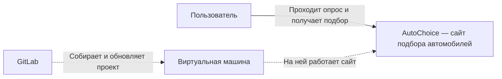
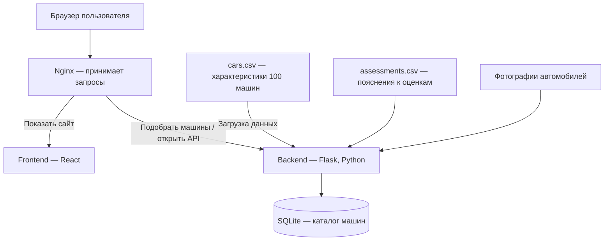
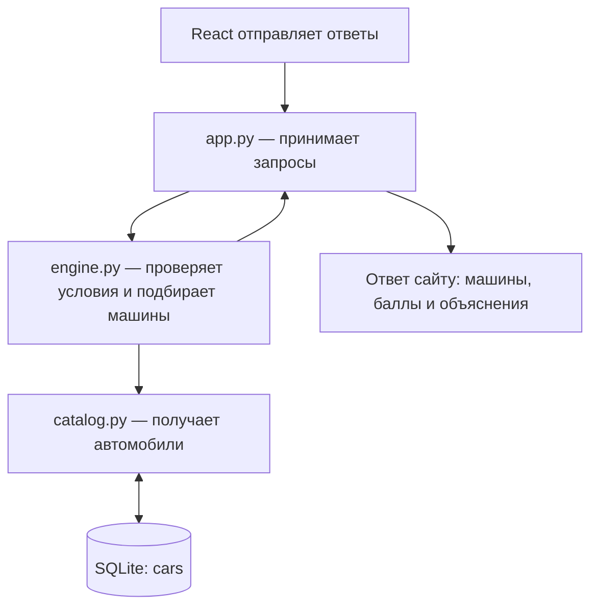
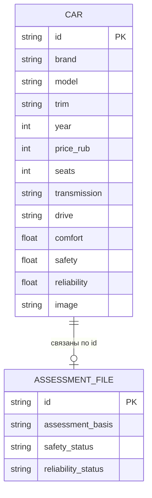
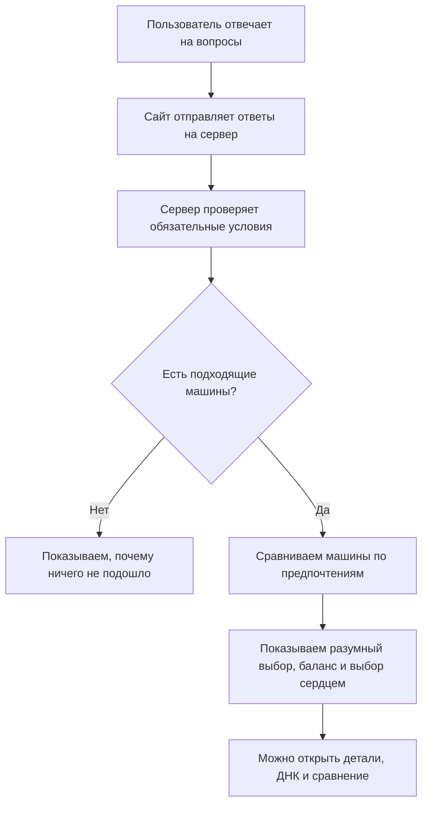

# AutoChoice — архитектура и данные простыми словами

**Проект:** AutoChoice — сайт, который помогает подобрать автомобиль под свои задачи и вкусы.  
**Сайт:** https://hack-ovb-08-vm1-86a371.vm.prodcontest.com/  
**Swagger (описание API):** https://hack-ovb-08-vm1-86a371.vm.prodcontest.com/api/docs

В этом документе показано, **из каких частей состоит наш проект и как они работают вместе**. Для этого используется подход **C4**: сначала смотрим на проект целиком, потом — на его основные части, а затем — на то, что находится внутри сервера. Все схемы сделаны в Mermaid, поэтому их можно просматривать прямо в Markdown-файле в GitLab.

## 1. C4 — уровень 1. Как человек пользуется AutoChoice

Пользователь открывает сайт, отвечает на вопросы о машине и выбирает понравившиеся фотографии. AutoChoice подбирает подходящие модели, показывает их плюсы и минусы, даёт возможность сравнить автомобили.

**Проще говоря:** GitLab помогает команде обновлять сайт, виртуальная машина держит его включённым, а пользователь просто заходит по ссылке. Для самого подбора платный искусственный интеллект не нужен — рекомендации рассчитывает наш алгоритм.

## 2. C4 — уровень 2. Из каких частей состоит сайт

На виртуальной машине AutoChoice работает в **трёх Docker-контейнерах**. Docker-контейнер — это отдельная среда для части программы.

| Часть | За что отвечает |
|---|---|
| **Nginx** | Принимает запросы по адресу сайта и направляет их в нужную часть приложения. Через него также настраивается HTTPS. |
| **Frontend (React)** | Всё, что видит человек: главная страница, 15 вопросов, карточки машин, сравнение, светлая и тёмная темы. |
| **Backend (Flask)** | Получает ответы, проверяет ограничения, рассчитывает рейтинг и отправляет результаты на сайт. |
| **SQLite** | Хранит каталог автомобилей. |
| **CSV и изображения** | Содержат исходные характеристики, пояснения к оценкам и фотографии. |

**Почему частей три?** Так удобнее поддерживать проект: внешний вид можно менять отдельно от алгоритма, а Nginx отвечает за доступ к сайту.

## 3. C4 — уровень 3. Как устроен Python-сервер

Внутри Backend основная работа разделена между тремя файлами.

| Файл | Простое объяснение |
|---|---|
| `backend/app.py` | «Приёмная»: получает запросы от сайта, вызывает нужные функции и возвращает результат. Здесь же Swagger, проверки состояния и логи. |
| `backend/engine.py` | «Мозг» подбора: понимает ответы, отсеивает неподходящие модели, считает оценки, формирует дуэли и автомобильную ДНК. |
| `backend/catalog.py` | «Библиотекарь»: читает каталог, проверяет данные и работает с SQLite. |

Например, если человек указал максимальный бюджет, алгоритм **сначала убирает слишком дорогие автомобили**, а уже потом сравнивает остальные по комфорту, стилю и другим пожеланиям.

## 4. Какие данные есть в проекте

Основная таблица базы данных называется **`cars`**. В ней одна строка — один автомобиль с его комплектацией. Второй таблицы для оценок нет: пояснения к ним хранятся в отдельном CSV-файле.

**Что означают блоки:**

- **Автомобиль (`Car`)** — марка, модель, цена, число мест, характеристики, оценки и фотография. Эти данные хранятся в SQLite.
- **Пояснение к оценке (`Assessment`)** — откуда взялись ориентировочные баллы безопасности и надёжности. Это **не таблица SQLite**, а файл `assessments.csv`.
- **Ответы (`Answers`)** — выбор пользователя в тесте. Сохраняются на стороне браузера и передаются серверу для расчёта; в отдельную таблицу SQLite не записываются.
- **Рекомендация (`RankedCar`)** — подходящий автомобиль с баллами и объяснением. Создаётся во время расчёта, а не хранится как отдельная запись в базе.
- **Автомобильная ДНК (`Dna`)** — краткий профиль предпочтений человека по его ответам.

*На схеме показаны только основные поля автомобиля, чтобы она оставалась понятной. В реальном каталоге характеристик больше.*

## 5. Как происходит подбор — по шагам

Если человек не указал достаточно предпочтений, AutoChoice предлагает уточнить ответы вместо того, чтобы придумывать персональную рекомендацию. Если обязательные условия слишком строгие, сервис объясняет, почему машин не нашлось.

### Как считаются баллы

У разных характеристик есть **веса** — насколько они важны человеку. Например, если он выбирает комфорт, то комфорт получает больший вес. Алгоритм берёт оценки характеристик, учитывает их веса и переводит итог в шкалу до 100 баллов.

\[
\text{Оценка} = 20 \times \frac{\text{сумма (оценка признака × его важность)}}{\text{сумма важностей}}
\]

Отдельно рассчитываются **практические пожелания** и **визуальные вкусы**. Поэтому результат можно посмотреть с трёх сторон: «Разумный выбор», «Выбор сердцем» и «Баланс». При неполном опросе показываемая оценка может быть дополнительно ограничена игровой шкалой. **Это не вероятность того, что покупка точно понравится.**

## 6. Где посмотреть работу сервера

- **Swagger:** https://hack-ovb-08-vm1-86a371.vm.prodcontest.com/api/docs — список методов API и их описание.
- **`POST /api/recommend`** — подобрать автомобили по ответам.
- **`POST /api/duels`** — получить пары фотографий для вопросов.
- **`POST /api/explain-car`** — объяснить, почему конкретная машина подходит или не подходит.
- **`GET /api/catalog/status`** — проверить, что каталог загружен.
- **`GET /health`** — проверить работу сервера.

## 7. Что важно понимать о проекте

AutoChoice — это **помощник в выборе**, а не сервис продажи автомобиля. В каталоге 100 машин. Баллы безопасности и надёжности — **предварительные сравнительные оценки**, а не официальные результаты краш-тестов или статистика поломок конкретных комплектаций.

**Коротко:** React показывает интерфейс, Flask выполняет подбор, SQLite хранит автомобили, а Nginx связывает всё в один сайт. Именно так AutoChoice работает от ответа на вопрос до готовой рекомендации.
